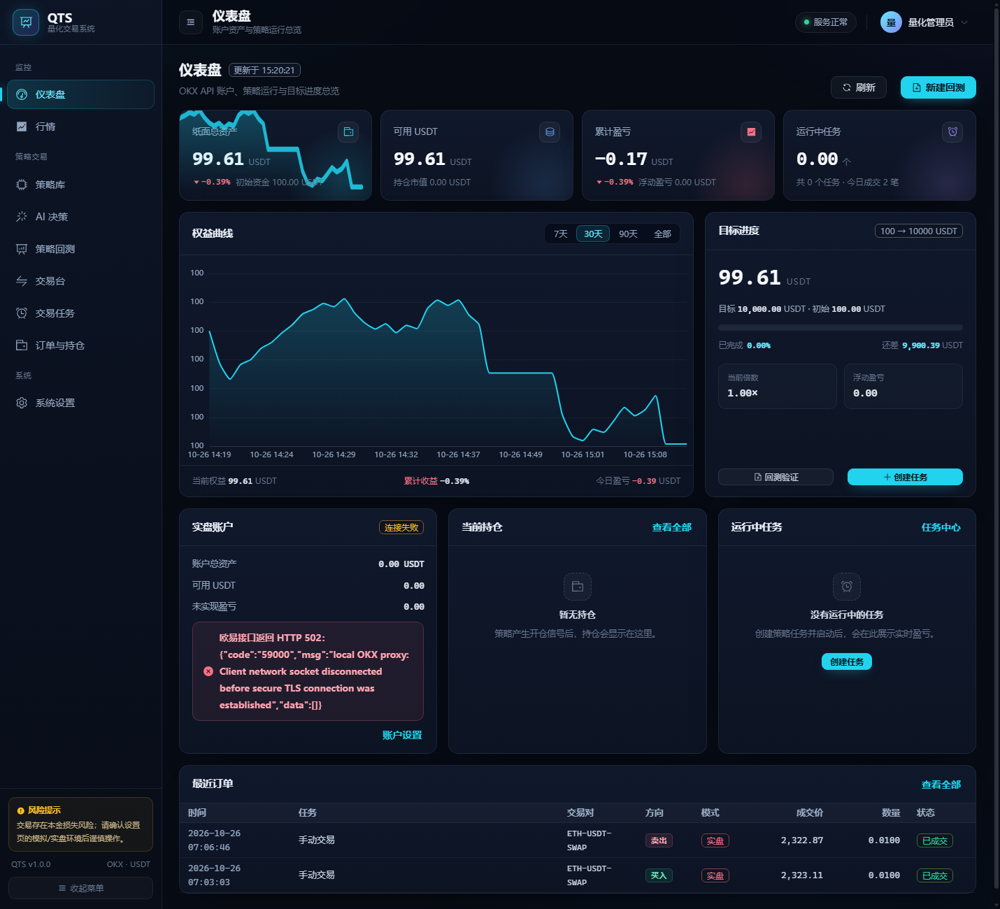
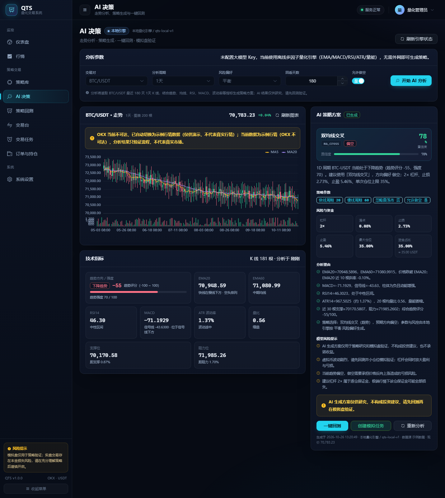
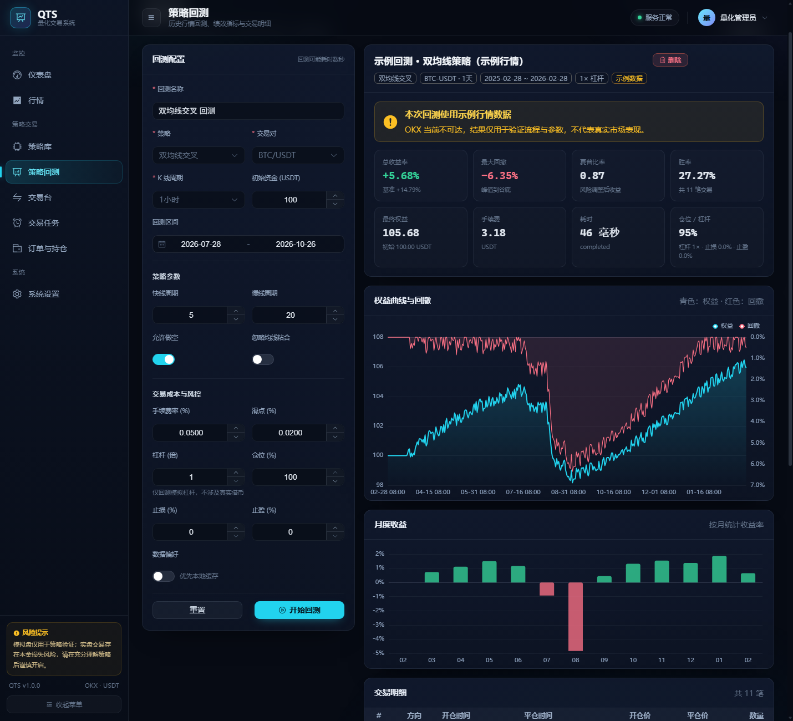

# QTS · 欧易量化交易系统

QTS 是一套面向欧易（OKX）的 Web 量化交易系统：C# / ASP.NET Core 10 + MySQL + SqlSugar + Autofac 后端，
Vue 3 + Vite + Element Plus + ECharts 前端，覆盖行情、策略库、历史回测、收益曲线、交易任务、订单持仓与系统设置。

> **风险提示**
> 本项目是量化交易**工具与教学/研究用系统**，不是收益承诺。默认使用演示/模拟账户，实盘交易开关默认关闭；
> 实盘需要用户主动配置欧易 API、确认 Key 所属环境并显式开启实盘开关，自行承担全部本金损失风险。
> “100 USDT → 10000 USDT”是账户目标追踪功能，不代表任何形式的收益保证。历史回测与示例行情不预示未来表现。



## 功能

- **仪表盘**：OKX API 账户总权益、可用保证金、浮动盈亏、账户连接状态、策略运行/持仓/订单概览、目标进度（未连接 API 时展示本地策略账本）。
- **行情中心**：6 个主流币对（BTC/ETH/SOL/XRP/DOGE/BNB）、7 档 K 线周期、MA5/MA20、成交量、一键同步全部交易对历史数据。
- **策略库**：4 个内置策略，参数表单由后端 schema 动态生成，全部支持做多/做空（`allowShort` 可关闭做空）。
  - `ma_cross` 双均线趋势（快/慢均线、EMA 可选）
  - `rsi_reversion` RSI 均值回归
  - `boll_breakout` 布林带突破 / 回归
  - `macd_trend` MACD 趋势
- **历史回测**：多空双向、可选 1–20 倍逐仓杠杆、次日开盘成交、手续费/滑点/仓位比例/止损止盈、逐 bar 权益、
  最大回撤、夏普、胜率、盈亏比、Buy & Hold 基准、月度收益、逐笔交易明细（含方向与保证金）、历史回测列表。
- **交易任务**：仅实盘 API 模式（纸面任务已停用），创建/编辑/启动/停止/删除，任务级杠杆（1–20）与滑点，60 秒级后台调度，
  仅在新 K 线收盘后处理信号，自动止损止盈，异常状态与错误信息落库。1× 多单走现货，杠杆 >1 或做空自动走 USDT 永续（逐仓），
  每笔持仓都可以在任务列表按市价 `reduceOnly` 平仓。
- **交易台（手动交易）**：直接读取 OKX API 账户，支持多/空、逐仓保证金、1–20 倍杠杆、滑点、止损止盈、
  一键快捷保证金、持仓实时盈亏与手动平仓；内置所选币种多周期 K 线图，策略任务仓位只读，避免误操作。
- **K 线显示**：支持“绿涨红跌 / 红涨绿跌”预设与自定义涨跌颜色，设置后行情、交易台、AI 决策页同步生效；
  交易默认只展示最近 60 根，用户放大后刷新不会自动缩回全量，并始终锚定最新 K 线。
- **AI 决策**：内置离线多因子引擎（EMA/MACD/RSI/ATR/量能/支撑阻力）分析走势，自动选出策略、参数、方向、
  杠杆、滑点与止损止盈，给出中文分析理由与风险提示；支持一键回测和创建 API 账户任务。默认无需外网、无需 API Key；
  也可通过配置接入任意 OpenAI 兼容大模型（OpenAI/DeepSeek/Kimi/通义/智谱/自定义），失败时自动回退本地引擎。
- **订单与持仓**：分页订单流水、当前持仓、方向、保证金/杠杆、未实现盈亏、任务归属。
- **系统设置**：OKX API 加密保存、连接测试、模拟/实盘环境切换、AI 模型服务、K 线配色、系统/数据库/行情源状态。
- **个人中心与多账号**：注册新账号、修改昵称/邮箱/密码；本地保存最多 8 个已登录账号，顶部菜单或个人中心一键切换；所有账号共享同一 OKX API 账户与交易数据。
- **离线演示**：OKX 不可达时自动回退到确定性合成行情，页面明确标注“示例数据”，不会伪装成真实行情。

## 技术栈

| 层 | 技术 |
| --- | --- |
| 后端 | .NET 10 / ASP.NET Core Web API、Autofac、SqlSugar 5.1、内置 OpenAPI |
| 数据库 | MySQL 8/9（utf8mb4），13 张业务表，CodeFirst 自动建表 |
| 认证 | PBKDF2-SHA256 密码哈希 + HMAC-SHA256 自包含 Token + 自定义 Bearer AuthenticationHandler |
| 密钥保护 | ASP.NET Core DataProtection 加密保存 OKX API Key/Secret/Passphrase |
| 前端 | Vue 3、Vite、Vue Router、Pinia、Axios、Element Plus、ECharts、原生 JS |
| 部署 | 前端构建到 `QTS/wwwroot`，由 ASP.NET Core 静态托管并做 SPA history fallback |

## 目录结构

```
QTS/
├─ QTS.slnx                      # 解决方案
├─ Directory.Build.props         # 构建产物重定向（受限 Windows 环境用，勿删）
├─ QTS/
│  ├─ Program.cs                 # 组合根：Autofac、认证、中间件、静态 SPA、HostedService
│  ├─ Controllers/               # Auth/Dashboard/Market/Tasks/Orders/Trade/Settings/Strategies/Backtests/Ai/Health
│  ├─ Services/                  # 行情、回测、任务、交易引擎、手动交易、AI 分析、模拟账户、仪表盘、设置、认证
│  ├─ Strategies/                # 4 个策略 + 注册表 + 参数归一化
│  ├─ Infrastructure/            # Auth/Okx/Middleware/Autofac 模块/JSON 配置
│  ├─ Workers/                   # TradingWorker（60s）、SampleDataWorker（首启示例回测）
│  ├─ Domain/ Contracts/ Data/   # 实体、DTO/接口、SqlSugar 初始化与种子
│  ├─ appsettings.json           # 连接串、认证密钥、日志
│  └─ wwwroot/                   # 前端构建产物（已包含可直接运行的构建）
├─ web/                          # Vue 3 前端源码 + 构建脚本
├─ docs/
│  ├─ API_CONTRACT.md            # REST 契约（含实现备注）
│  ├─ OKX_SETUP.md               # 欧易模拟盘/实盘安全配置与联调指南
│  ├─ UI_SPEC.md                 # UI 规范
│  └─ screenshots/               # 15 张验收截图
└─ App_Data/keys/                # DataProtection 密钥（首次运行生成，勿提交）
```

## 快速启动

### 1. 环境要求

- .NET SDK 10（已验证 10.0.402）
- MySQL 8.0+（已验证 9.7.1）
- Node.js 20+ / npm 10+（验证 v24.20.0 / 11.19.0）；仅重新构建前端时需要

### 2. 初始化数据库

```sql
CREATE DATABASE IF NOT EXISTS qts CHARACTER SET utf8mb4 COLLATE utf8mb4_general_ci;
CREATE USER IF NOT EXISTS 'qts'@'localhost' IDENTIFIED BY 'Qts@2026!';
GRANT ALL PRIVILEGES ON qts.* TO 'qts'@'localhost';
FLUSH PRIVILEGES;
```

如需改账号，请同步修改 `QTS/appsettings.json` 的 `ConnectionStrings:MySql`。首次启动会自动建表并写入种子数据。

### 3. 启动后端（推荐一键脚本）

在仓库根目录双击或执行：

```bat
start.bat
```

脚本会自动检查 5088 端口、编译项目并启动，成功后打开浏览器。停止服务：

```bat
stop.bat
```

重启：

```bat
restart.bat
```

也可以手动启动：

```powershell
dotnet restore
dotnet build QTS/QTS.csproj
dotnet run --project QTS/QTS.csproj --no-build --urls http://localhost:5088
```

打开 <http://localhost:5088>。默认管理员：**admin / admin123**（首次登录建议在设置页修改密码）。
`wwwroot` 已包含构建产物，因此不装 Node 也能直接运行完整界面。

> **常见启动问题**
> - `MSB3027 / MSB3026: ... QTS.exe because it is being used by another process`：
>   上一次的 QTS 还在运行，先执行 `stop.bat`（或关掉旧命令行窗口），再运行 `start.bat`。
> - `Failed to bind to address http://localhost:5088: address already in use`：
>   端口被占用，执行 `stop.bat`；或在 `scripts/start.ps1`/命令行中换一个端口。
> - `无法加载文件 ... 未对文件进行数字签名`：
>   请通过 `start.bat` 启动（内部已使用 `-ExecutionPolicy Bypass`），不要直接右键运行 `.ps1`。
> - 后端已启动但页面打不开：确认访问的是 <http://localhost:5088>，并检查防火墙/端口。

### 4. 前端开发（可选）

```powershell
cd web
npm install --cache .npm-cache
npm run dev        # http://localhost:5173，/api 代理到 5088
npm run build      # 产出到 QTS/wwwroot
```

> `web/scripts/build.mjs` 兼容受限沙箱：正常环境使用官方 esbuild，子进程管道被禁用时自动降级到 terser。
> 如 npm 默认缓存不可写，请加 `--cache .npm-cache`。

### 5. 数据库重置

```sql
DROP DATABASE qts;
CREATE DATABASE qts CHARACTER SET utf8mb4 COLLATE utf8mb4_general_ci;
```

重启后端即可重建表结构、admin 账号和 4 个策略；`SampleDataWorker` 会生成一条明确标注
“示例行情”的演示回测。API 账户与 K 线配色不受数据库重置影响（API Key 加密存于数据库，重置后需重新保存）。

## 使用说明

1. **接入 OKX API 账户**：先在“系统设置”保存 API Key / Secret / Passphrase，并做连接测试。当前账户可在
   “OKX 模拟环境”与真实环境之间切换；页面会明确显示 API 账户总权益、可用保证金与持仓。
2. **交易任务**：新建任务现在只支持实盘 API 模式（历史纸面任务已停用）。选择策略/币对/K 线 → 设置杠杆/滑点 →
   启动；后台每 60 秒扫描一次，只有出现新收盘 K 线才执行，避免同根 K 线重复下单。
3. **交易台（手动交易）**：进入“策略交易 → 交易台”，选择交易对与多/空方向，填写保证金、杠杆（1–20×）、滑点与
   可选止损止盈，直接发送到 OKX API 账户；持仓卡支持按当前滑点 `reduceOnly` 平仓。
4. **历史回测**：策略回测页配置区间、初始资金、手续费、滑点、仓位、杠杆、止损止盈；提交后可在详情查看收益/回撤曲线、
   月度收益和逐笔交易（含方向）。OKX 不可达时自动使用示例行情并显示黄色警告。
5. **AI 决策**：进入“策略交易 → AI 决策”，选择交易对、周期、风险偏好、回看天数与是否允许做空，点击“开始 AI 分析”。
   本地引擎会给出趋势评分、指标快照、策略方案、参数、杠杆/滑点/止损止盈与中文理由；可直接一键回测或创建 API 账户任务。
   默认离线运行；如需大模型增强，可在“系统设置 → AI 决策引擎”的“模型服务”下拉中选择 DeepSeek、OpenAI、Kimi、
   通义千问、智谱 GLM 或“自定义（OpenAI 兼容）”，Base URL 与模型名会自动填充且可修改，再填写 API Key 即可
   （加密保存，无需重启）。也可通过环境变量 `Ai__Enabled`、`Ai__Provider`、`Ai__BaseUrl`、`Ai__ApiKey`、`Ai__Model`
   配置默认值。大模型只负责方案改写，策略代码/参数/风控仍由本地校验。AI 方案仅供研究，必须先回测再小仓验证。
6. **真实账户交易**（高风险，务必先用最小仓位验证）：
   - 在欧易创建 **读取 + 交易** 权限的 API Key，**禁止开启提币权限**，并绑定 IP 白名单；
   - 在“系统设置”保存 API Key / Secret Key / Passphrase，先做连接测试；
   - 确认当前“OKX 模拟环境”开关状态：演示 Key 必须保持开启；真实 Key 需关闭该开关后重新测试连接。
     如果 OKX 返回 `50101 APIKey does not match current environment`，说明该 Key 属于另一个环境，不能用于真实账户；
   - 在“系统设置 → 允许实盘交易”显式开启；新建任务/手动交易都会再次校验凭据与开关；
   - **执行规则**：1× 多单走币币现货；杠杆 >1 或做空自动走 USDT 永续合约（逐仓），
     下单张数按 OKX 合约面值/最小变动单位换算；平仓统一使用 `reduceOnly`；
   - 详细步骤见 [docs/OKX_SETUP.md](docs/OKX_SETUP.md)。
7. **安全建议**：生产环境必须修改 `Auth:Secret`、修改默认密码、通过环境变量注入数据库密码、
   为站点启用 HTTPS，并定期备份 `App_Data/keys`（丢失后已保存的欧易凭据无法解密）。

## API

完整契约见 [docs/API_CONTRACT.md](docs/API_CONTRACT.md)。统一响应信封：

```json
{ "success": true, "data": { }, "message": null }
{ "success": false, "data": null, "message": "友好错误信息", "code": "OPTIONAL_CODE" }
```

除 `GET /api/health` 与 `POST /api/auth/login` 外均需 `Authorization: Bearer <token>`。主要端点：

| 模块 | 端点 |
| --- | --- |
| 认证 | `POST /api/auth/login`、`GET /api/auth/me`、`POST /api/auth/change-password` |
| 仪表盘 | `GET /api/dashboard/overview`、`GET /api/dashboard/equity-curve?range=7d\|30d\|90d\|all` |
| 行情 | `GET /api/market/instruments`、`/candles`、`/ticker`、`POST /api/market/sync`、`/sync-all` |
| 策略/回测 | `GET /api/strategies`、`GET/POST /api/backtests`、`GET/DELETE /api/backtests/{id}` |
| 任务 | `GET/POST /api/tasks`、`GET/PUT/DELETE /api/tasks/{id}`、`POST /api/tasks/{id}/start\|stop`、`POST /api/tasks/{id}/close-position` |
| 交易台 | `GET /api/trade/overview`、`POST /api/trade/open`、`POST /api/trade/close`（OKX API 账户） |
| AI 决策 | `GET /api/ai/status`、`POST /api/ai/analyze` |
| 订单/持仓 | `GET /api/orders`、`GET /api/positions?status=open` |
| 设置 | `GET/PUT /api/settings/okx`、`POST /api/settings/okx/test`、`GET /api/settings/okx/contract`、`GET/PUT /api/settings/ai`、`GET /api/settings/system` |
| 健康检查 | `GET /api/health` |

OpenAPI 文档（Development）：<http://localhost:5088/openapi/v1.json>。

## 回测与撮合口径

- 信号在 K 线**收盘后**计算，**下一根 K 线开盘价**成交，避免未来函数；
- 策略信号为 `1` 做多、`0` 空仓、`-1` 做空；做空开仓先卖后买回，方向感知滑点与止损/止盈；
- 逐仓保证金模型：开仓冻结 `保证金`，名义价值 = 保证金 × 杠杆；手续费 0.1%；最大亏损不超过该仓保证金；
- 手续费默认 0.1%、滑点默认 0.05%，均可配置；回测默认杠杆 1×，支持 1–20×；
- 止损/止盈按 K 线高低点触发（默认关闭，0 表示关闭），多空方向分别计算触发价；
- 权益 = 可用现金 + 占用保证金 + 浮动盈亏，曲线按逐 bar 收盘价估值；最大回撤按峰值回撤计算，夏普按逐 bar 收益年化（无风险利率 0）；
- 合成行情由固定公式 + 确定性伪随机生成，多周期共享同一价格路径，仅用于离线功能验证，**不具备统计意义**。

## 验收截图

| AI 决策（新增） | 回测详情 |
| --- | --- |
|  |  |

更多截图：[登录](docs/screenshots/01-login.png) · [仪表盘](docs/screenshots/02-dashboard.png) ·
[行情](docs/screenshots/03-market.png) · [策略库](docs/screenshots/04-strategies.png) ·
[策略回测](docs/screenshots/05-backtest.png) · [任务](docs/screenshots/06-tasks.png) ·
[订单持仓](docs/screenshots/07-orders.png) · [设置](docs/screenshots/08-settings.png) ·
[交易台](docs/screenshots/10-trade.png) · [AI 配置](docs/screenshots/12-settings-ai.png) ·
[AI 一键回测](docs/screenshots/11-ai-backtest.png) · [K 线配色](docs/screenshots/13-kline-colors.png) ·
[Live 合约任务](docs/screenshots/14-task-live-contract.png) · [个人中心](docs/screenshots/16-profile.png) ·
[注册](docs/screenshots/17-register.png) · [真实 API 账户](docs/screenshots/15-real-account.png)

## 已验证状态

- `dotnet build QTS/QTS.csproj`：**0 error**（离线环境仅 NuGet 漏洞源 NU1900 警告）。
- `npm run build`：构建成功，产物输出至 `QTS/wwwroot`（含 TradeView 交易台与 AiView AI 决策）。
- 端到端：登录、仪表盘、行情 300 根 K 线、4 策略（含 `allowShort`）、示例回测 +5.68%（合成行情、最大回撤 6.35%）、
  任务全生命周期、手动做多/做空 1×–5×、手动平仓、任务 5× 空头自动交易与删除自动平仓、5× 杠杆回测（多空双向）、
  订单/持仓（方向/保证金/杠杆）、OKX 未配置测试、模拟盘重置、运行中任务删除保护、非法策略/实盘任务拒绝。
- 合约链路（仅 OKX 模拟环境）：读取账户 `net_mode` 与 ETH/BTC 永续规格（ETH ctVal=0.1、BTC ctVal=0.01）；
  以 2× 逐仓真实开出/平掉最小 ETH 永续仓；Live 任务成功开出 ETH-USDT-SWAP 多单并通过 `close-position` 以
  `reduceOnly` 平仓，PnL/手续费/订单落库；手动交易台已改为直接读取/交易 OKX API 账户，成功显示账户权益
  ≈98k USDT、可用 ≈5k USDT，并完成手动开仓/平仓；**尚未在真实资金环境下单**。
- **真实资金最小仓验证已完成**（2026-10-26）：真实环境 ETH-USDT-SWAP 做多，0.01 张（0.001 ETH）、3× 逐仓，
  开仓 2324.43（OKX orderId `4043337784531226624`），约 14 秒后 `reduceOnly` 平仓 2324.10
  （OKX orderId `4043338265768890368`）；价差毛利约 **-0.00033 USDT**，手续费约 0.0023 USDT（以 OKX 账单为准），
  已确认平仓、无持仓。当前真实权益约 **15.06 USDT**、可用约 **7.72 USDT**；订单在 OKX App 可见。
- 普通桌面进程通过 `start.bat` 启动时会自动拉起本机 TLS 代理（127.0.0.1:5090）；设置页显示代理地址属正常，
  不影响 OKX 签名与账户读取。
- AI：`/api/ai/status` 本地引擎；1D BTC 多因子分析给出 ma_cross 空头方案，一键回测 +2.80%（合成行情、2 笔交易）；
  设置页支持 OpenAI/DeepSeek/Kimi/通义/智谱/自定义下拉，切换自动填充 Base URL 与模型名，API Key 加密保存；
  可选大模型接口失败自动回退本地引擎。
- K 线：红涨绿跌 / 绿涨红跌预设与自定义颜色保存到浏览器，设置页 CDP 实测切换成功；交易台默认 60 根、
  缩放保持逻辑已实现，最终产物由前端构建验证。
- UI 自动化（Edge headless + CDP）：登录、仪表盘、行情、策略库、回测、交易台、AI 决策、任务、订单持仓、设置
  共 **12 个页面**渲染正常（新增注册、个人中心），AI 分析/一键回测可用；设置页服务商下拉/模型列表验证通过，交易台、AI 页与设置页
  **console error = 0**。
- 当前运行环境 Windows Schannel 与 OKX 边缘节点存在 TLS 握手不稳定，已内置 `scripts/okx-proxy.mjs` 本地 TLS
  代理（`start.bat` 自动启动），QTS 通过 `http://127.0.0.1:5090` 访问 OKX；请求仍由 Node OpenSSL 完成 TLS，
  业务签名不变。若在受限沙箱/容器中启动 .NET，Windows Schannel 可能报 TLS 凭证错误，改用 `start.bat` 即可。

## 已知限制

- 单管理员账号，未做多租户/角色权限；
- 回测在进程内同步执行，超大区间可能耗时较长（已有请求超时与数据量限制）；
- **API 账户合约交易已在 OKX 模拟环境完整验证，并完成真实资金最小仓验证**；实盘杠杆/做空前必须确认 Key 所属环境、
  账户持仓模式、合约规格与最小下单量。手动交易台已改为 API 账户，不再使用内部纸面账户；
- Live 任务的有效保证金 = 分配资金 × 最大仓位%。BTC-USDT-SWAP 最小名义约 8 USDT、ETH 约 2.3 USDT；若低于最小张数，
  任务会返回“可用保证金不足”的中文建议（不再直接抛 OKX 59103），可提高杠杆、增加分配资金/最大仓位% 或改用 ETH；
- 合约下单未处理资金费率、维持保证金/强平引擎、部分成交与滑点保护；极端行情下实际成交可能与预期差异较大；
- 杠杆模拟为逐仓保证金近似，仅用于策略验证与教学；
- AI 决策默认使用离线多因子引擎，结果只用于研究与流程演示，不构成投资建议；可选大模型输出会经过本地策略/参数校验，
  但仍可能产生不适合当前市场的方案，必须回测后再使用；
- 时间字段部分使用 MySQL `DATETIME`，序列化不带时区后缀，前端已按本地时间兼容；
- `Directory.Build.props` 将构建产物放到 `build-tmp/`，这是为规避当前 Windows 目录 ACL 限制；正常环境可删除。

## 免责声明

本项目按“现状”提供，不构成投资建议。加密货币交易具有极高风险，可能导致全部本金损失。使用实盘功能前，
请确认你已理解策略逻辑、API 权限、滑点与网络故障风险，并自行做好风控与资金管理。
